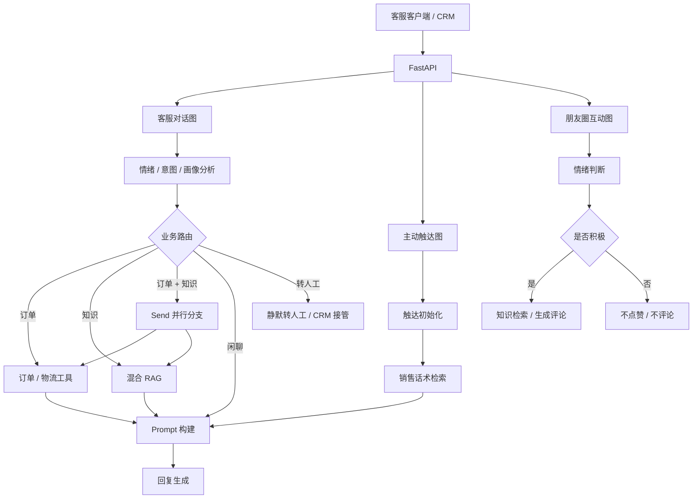

# AI Customer Service

面向电商客服与私域运营的 AI 智能体服务，基于 **LangGraph + FastAPI + 混合 RAG** 构建，覆盖商品咨询、订单与物流查询、售后转人工、CRM 主动触达及朋友圈互动。

项目将通用智能体基础设施与业务流程分层，支持多品牌 Persona、多个知识库集合和多轮会话，提供知识库管理页面、入库 CLI、质量验证与部署运维脚本。

## 核心能力

| 能力 | 实现方式 |
| --- | --- |
| 客服对话 | 单次 LLM 分析情绪、意图与画像，按业务条件路由，返回完整回复与分条消息 |
| 多意图处理 | 同时命中订单与知识咨询时，通过 LangGraph `Send` 并行执行工具查询与 RAG |
| 混合检索 | Milvus 语义检索 + jieba/BM25 关键词检索，加权 RRF 融合与内容去重 |
| 人工接管 | 命中转人工条件后进入独立节点，静默返回，由 CRM 承接发话；支持 webhook |
| 主动触达 | 独立 outreach 子图，根据客户生命周期与销售话术生成触达消息 |
| 多品牌配置 | 按 `bot_id` / `brand` 加载 Persona、知识库与业务规则，支持角色配置管理 |
| 多轮记忆 | 异步 checkpointer，Redis → PostgreSQL → 进程内 Memory 降级与连接重建 |
| 知识库维护 | 文件解析、文本清洗、分块、双路写入、暂存区，以及按来源替换与删除 |
| 服务治理 | API Key、Redis 分布式限流、健康检查、异常响应处理与可选 LangSmith 跟踪 |

## 系统架构



**分析与生成分工。** 分析模型负责结构化情绪、意图及槽位提取，生成模型负责回复；可分别配置模型和温度。闲聊跳过知识检索，主动触达跳过用户消息分析。

**检索与知识维护。** 向量侧使用 Milvus，关键词侧从 PostgreSQL 加载文档并通过 jieba 与 `rank_bm25` 排序，再使用加权 RRF 融合。两路检索并发执行，配置独立等待超时及异常降级。默认采用 Ollama `bge-m3`（1024 维），文档入库与实时查询向量化都需要 Embedding 服务。

**CRM 协作。** 客服接口接收 `scene`、`journey_stage`、`intent_level`、`customer_profile`，返回画像更新和阶段建议供 CRM 持久化。主动触达接口返回精简消息契约；详细字段以 [CRM 生命周期约定](docs/journey_stage_spec.md) 和实际接口模型为准。

## 技术栈

| 层次 | 技术 |
| --- | --- |
| 智能体与模型 | LangGraph 1.x、LangChain 1.x、OpenAI 兼容接口；框架另提供 Anthropic / Ollama 适配 |
| API 与配置 | Python、FastAPI、Uvicorn、Pydantic Settings、httpx |
| 检索与存储 | Milvus、PostgreSQL 16、jieba、rank_bm25、Ollama / bge-m3 |
| 会话与限流 | LangGraph Checkpointer、psycopg 连接池、Redis |
| 文档与数据 | pypdf、python-docx、openpyxl、pandas、繁简转换 |
| 部署与维护 | Docker 多阶段构建、Docker Compose、Nginx、Alembic、pytest |

## 快速开始

建议使用 **Python 3.12**（与 Docker 镜像一致），以及 Docker Engine / Docker Desktop 和 Docker Compose v2。首次启动需要下载依赖、镜像和 Embedding 模型。

### 1. 获取项目并配置环境

```bash
git clone https://github.com/FaithlessKnight/ai-customer-service.git
cd ai-customer-service
cp .env.example .env
```

Windows PowerShell 使用 `Copy-Item .env.example .env`。编辑 `.env`，至少设置以下配置；模型名应替换为提供商实际可用且支持结构化输出的模型：

```dotenv
OPENAI_API_KEY=your-api-key
OPENAI_BASE_URL=https://api.openai.com/v1
OPENAI_MODEL=gpt-4o-mini
ANALYSIS_MODEL=gpt-4o-mini
GENERATOR_MODEL=gpt-4o-mini

EMBEDDING_PROVIDER=ollama
EMBEDDING_MODEL=bge-m3
OLLAMA_EMBEDDING_MODEL=bge-m3
EMBEDDING_DIM=1024
OLLAMA_BASE_URL=http://localhost:11434

PG_HOST=localhost
PG_USER=postgres
PG_PASSWORD=replace-with-your-password
PG_DATABASE=agent_db
MILVUS_HOST=localhost
REDIS_URL=redis://localhost:6379
```

使用 DashScope 等兼容接口时，同时修改 `OPENAI_BASE_URL` 与模型名。**显式设置 `ANALYSIS_MODEL` 和 `GENERATOR_MODEL`**：两者有各自默认值，仅修改 `OPENAI_MODEL` 不会自动覆盖。

订单与商品业务接口需要自行配置 `BACKEND_BASE_URL` 及对应路径；Elasticsearch 历史与 CRM 转人工回调按需配置。`.env.example` 中的业务地址是示例，需替换为自己的服务。

### 2. 启动基础设施与 Embedding

```bash
docker compose up -d postgres redis etcd minio milvus-standalone ollama
docker compose exec ollama ollama pull bge-m3
```

Milvus 首次启动可能需要较长时间，可使用 `docker compose ps` 查看状态。

### 3. 本地开发运行

```bash
python -m venv .venv
```

激活虚拟环境：Linux / macOS 执行 `source .venv/bin/activate`；Windows PowerShell 执行 `.\.venv\Scripts\Activate.ps1`。

```bash
python -m pip install -r requirements.txt
python scripts/migrate.py upgrade
uvicorn api.main:app --reload --host 0.0.0.0 --port 8000
```

开发环境入口：

- Swagger：[http://localhost:8000/docs](http://localhost:8000/docs)
- 存活检查：[http://localhost:8000/ping](http://localhost:8000/ping)
- 依赖健康检查：[http://localhost:8000/health](http://localhost:8000/health)
- Persona 管理：[http://localhost:8000/admin/](http://localhost:8000/admin/)
- 知识库管理：[http://localhost:8000/admin/ingest](http://localhost:8000/admin/ingest)

`ENVIRONMENT=production` 时关闭 Swagger / ReDoc / OpenAPI 文档入口。启用 API Key 后，受保护接口需要携带 `X-API-Key`。

### 4. 导入知识库

新环境需要先入库，才能检索到产品或销售话术内容：

```bash
# 先预览产品分块，再正式写入
python scripts/kb.py ingest "product/新肌秀舒净雅香沐浴乳/新肌秀舒净雅香沐浴乳_知识库.md" --category "沐浴乳" --dry-run
python scripts/kb.py ingest "product/新肌秀舒净雅香沐浴乳/新肌秀舒净雅香沐浴乳_知识库.md" --category "沐浴乳" --replace

# 话术目录自动映射到 sales_script
python scripts/kb.py ingest data/sales_scripts --replace
python scripts/kb.py status
python scripts/kb.py list --collection products
```

`products` 入库需提供 `--category`，也可通过 `KB_PRODUCTS_DEFAULT_CATEGORY` 设置默认分类。`--replace` 按 `source_file` 删除旧块后重新写入；Milvus 实体统计可能延迟变化，应结合按来源列表与实际检索结果验收。更多操作见 [知识库 CLI 文档](scripts/kb/README.md)。

## 接口示例

以下为 Bash / Git Bash 的 `curl` 示例；PowerShell 可使用 `Invoke-RestMethod` 发送等价 JSON。启用鉴权时增加 `-H "X-API-Key: 你的密钥"`。

### 客服对话

```bash
curl -X POST http://localhost:8000/cs \
  -H "Content-Type: application/json" \
  -d '{"message":"这款沐浴乳适合什么肤质？","session_id":"demo-chat-001","collections":["products"]}'
```

响应包含 `reply`、`reply_parts`、`intent`、`intents`、`emotion`、`need_human_transfer` 等字段。同一用户的连续对话应保持 `session_id` 一致；订单查询还需传入业务系统的 `user_id`。

当 `need_human_transfer=true` 时，客户端应交由 CRM / 人工处理，允许 `reply` 为空，不应将空消息作为失败重试。接口字段、品牌配置与生命周期约定见 [客服 API 文档](CS_API_DOC.md)。

### CRM 主动触达

```bash
curl -X POST http://localhost:8000/cs/outreach \
  -H "Content-Type: application/json" \
  -d '{"user_id":"demo-user","session_id":"outreach:demo-user:001","scene":"trial_not_used","journey_stage":1,"trial_received":true,"trial_used":false,"intent_level":50,"collections":["sales_script"]}'
```

支持的 `scene`：`trial_not_used`、`trial_used`、`first_order_no_rebuy`。触达时机与频控由调用方 CRM 管理。

### 朋友圈互动

```bash
curl -X POST http://localhost:8000/moments \
  -H "Content-Type: application/json" \
  -d '{"content":"今天终于完成了自己的小目标，开心！","session_id":"demo-moments-001"}'
```

返回 `like`、`comment`、`session_id`；该接口生成互动决策和文案，实际点赞与发布由调用方执行。详见 [朋友圈 API 文档](MOMENTS_API_DOC.md)。

### 主要接口

| 方法 | 路径 | 用途 |
| --- | --- | --- |
| POST | `/cs` | 客服多轮对话 |
| POST | `/cs/outreach` | CRM 主动触达文案 |
| GET | `/cs/debug/{session_id}` | 会话状态与检索调试信息 |
| POST | `/moments` | 朋友圈互动决策 |
| POST | `/ingest/texts` | 文本入库 |
| POST | `/ingest/upload` | 上传文件到暂存区 |
| GET / POST | `/ingest/staging` / `/ingest/staging/run` | 查询暂存状态 / 执行入库 |
| DELETE | `/ingest/document` | 按文件名删除知识块 |
| GET / POST / DELETE | `/admin/personas` 及其子路径 | Persona 查询与维护 |
| GET | `/ping` / `/health` | 存活 / 依赖健康检查 |

当前注册的业务路由以 `/cs` 为主；部分历史注释中的 `/chat` 不代表已提供该接口。

## Docker 多实例部署

Compose 定义了 **3 个 API 实例 + Nginx**，以及 PostgreSQL、Redis、Milvus（etcd + MinIO）和 Ollama。Nginx 当前使用 `least_conn` 分发请求；Dockerfile 使用多阶段构建、非 root 用户和每实例 4 个 Uvicorn worker。

完成基础设施启动和模型下载后：

```bash
docker compose up -d --build api-1 api-2 api-3

# .dockerignore 排除了 data/，首次部署需将初始配置与话术复制到共享数据卷
docker compose cp data/. api-1:/app/data
docker compose exec --user root api-1 chown -R appuser:appuser /app/data
docker compose restart api-1 api-2 api-3

docker compose exec api-1 python scripts/migrate.py upgrade
docker compose exec api-1 python scripts/kb.py ingest "product/新肌秀舒净雅香沐浴乳/新肌秀舒净雅香沐浴乳_知识库.md" --category "沐浴乳" --replace
docker compose exec api-1 python scripts/kb.py ingest data/sales_scripts --replace
```

配置 `deploy/nginx.conf` 中的域名，并将自己的 `fullchain.pem` 与 `privkey.pem` 放入 `deploy/certs/` 后启动入口：

```bash
docker compose up -d nginx
docker compose ps
docker compose logs -f api-1 api-2 api-3 --tail 100
```

API 实例未直接映射宿主机 8000 端口，Compose 部署通过 Nginx 域名访问；本地开发则使用 Uvicorn 的 8000 端口。已有数据卷升级时，按需更新配置文件，避免覆盖运行中的 Persona 数据。

生产配置中设置 `ENVIRONMENT=production`、`API_SECRET_KEY` 和明确的 `ALLOWED_ORIGINS`，保持 `RATE_LIMIT_ENABLED=true`（当前关闭该开关也会跳过 API Key 校验）。证书、私钥、`.env`、上传文件、日志与备份不纳入版本管理。

## 测试与运维

```bash
# 本地规则与接口契约回归，接口测试使用 StubAgent
python -m pytest tests/test_security_regressions.py tests/test_cs_api_regressions.py -q

# 真实模型 / 数据库集成验证，需先配置服务和知识库
docker compose exec api-1 python scripts/test/test_conversation.py
docker compose exec api-1 python scripts/test/verify_rag_quality.py

# 巡检与迁移状态
docker compose exec api-1 python scripts/ops/healthcheck.py
docker compose exec api-1 python scripts/migrate.py check
```

性能评测入口位于 `scripts/benchmark/`，测试结果依赖模型、硬件、知识库规模与并发配置；仓库不承诺固定的响应时延、QPS 或准确率。`tests/test_cs_api_palm.py` 是直接调用本地 API 的联调脚本，不宜作为独立单元测试全量收集。

Linux / WSL / Git Bash 可使用 `make health`、`make logs`、`make backup-pg`、`make restart-api` 等命令。完整说明见 [运维手册](docs/运维手册.md) 和 [脚本索引](scripts/README.md)。

## 目录结构

```text
ai-customer-service/
├── agent_framework/          # 通用图构建、模型配置、检索、记忆与入库管道
├── agents/
│   ├── customer_service/     # 客服 / 主动触达图、节点、Persona、业务规则
│   └── moments/              # 朋友圈情绪分析与互动图
├── api/                      # FastAPI 路由、鉴权限流、管理页面
├── data/                     # Persona 配置、词典、话术与知识文档
├── product/                  # 产品知识库与文档模板
├── scripts/                  # 知识库 CLI、评测、测试、运维脚本
├── tests/                    # 规则与接口回归测试
├── migrations/               # Alembic 数据库迁移
├── deploy/                   # Nginx 配置与本地证书目录
├── docs/                     # 业务流程、CRM 字段契约、运维与项目说明
├── docker-compose.yml
├── Dockerfile
└── .env.example
```

## 实现边界与排错

- **Redis checkpoint 降级**：`langgraph-checkpoint-redis` 需要 Redis Stack / RediSearch；当前 Compose 使用普通 Redis 7，checkpoint 通常降级至 PostgreSQL，Redis 仍可提供分布式限流。Memory fallback 仅适合开发，无法跨进程共享且重启丢失。
- **检索超时**：当前使用线程池等待结果，超时后会舍弃该路结果，但不能中断已运行的底层查询，因此不等于严格的端到端时限。
- **模型或向量维度错误**：核对分析 / 生成模型权限、Ollama 模型是否下载，以及 `EMBEDDING_DIM` 是否与已有 Milvus collection 一致。
- **双库一致性**：PG 与 Milvus 分别写入，当前不提供跨存储事务；异常后需按来源检查，必要时重新入库。
- **知识库暂存 CLI**：其默认 TaskRunner 的检索器注入与 API 侧存在差异；需要 PG / Milvus 双写时优先使用已明确配置的 `kb.py ingest`，详见 CLI 文档。
- **业务集成**：订单、商品价格、外部历史和 CRM 回调依赖实际业务服务；仅启动本仓库不会自动获得业务数据或消息发送能力。

## 相关文档

- [客服接口说明](CS_API_DOC.md)
- [朋友圈接口说明](MOMENTS_API_DOC.md)
- [业务流程](docs/business_flow.md)
- [CRM 生命周期字段约定](docs/journey_stage_spec.md)
- [知识库 CLI](scripts/kb/README.md)
- [部署与运维](docs/运维手册.md)
- [简历项目描述](docs/resume_project.md)
